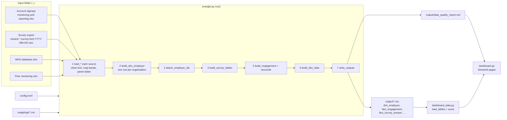
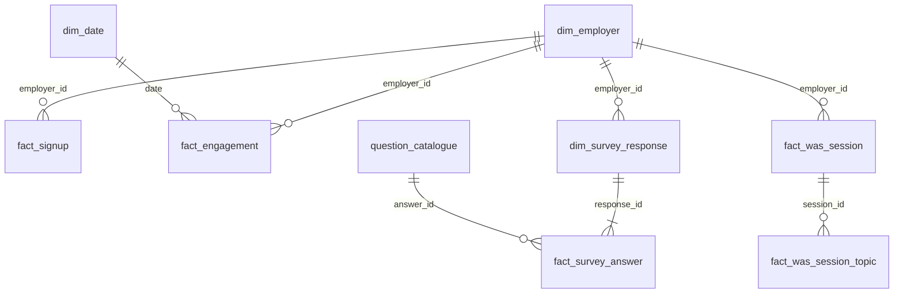

# HWW pipeline guide

This guide explains how the Healthy Working Wales (HWW) dashboard gets from four spreadsheets to
the charts. It is for someone who is comfortable with Python but new to pandas. Read it top to
bottom the first time. After that, use it as a reference.

Contents

1. [The 5-minute version](#1-the-5-minute-version)
2. [Just enough pandas](#2-just-enough-pandas)
3. [Data flow](#3-data-flow)
4. [What happens when you run `python wrangle.py`](#4-what-happens-when-you-run-python-wranglepy)
5. [Function by function: wrangle.py](#5-function-by-function-wranglepy)
6. [Function by function: dashboard_data.py and dashboard.py](#6-function-by-function-dashboard_datapy-and-dashboardpy)
7. [One organisation, start to finish: Org 11](#7-one-organisation-start-to-finish-org-11)
8. [Design decisions and why](#8-design-decisions-and-why)
9. [Questions another developer is likely to ask](#9-questions-another-developer-is-likely-to-ask)

Numbers in this guide come from the dummy input files in the folder above `hww_poc_code`. The
synthetic copies the tests use, in `tests/data/inputs/`, give exactly the same numbers.

How the prototype relates to the production route (py-common → BigQuery → Dataform → Power BI)
is in [architecture.md](architecture.md).

---

## 1. The 5-minute version

There are two programs and a set of settings files. The programs are modules of the installable
package `hww_dashboard` in `src/`; the scripts `wrangle.py` and `dashboard.py` in the project
folder are small launchers that keep the commands `python wrangle.py` and
`streamlit run dashboard.py` working.

| Piece | Job |
|---|---|
| [`wrangle.py`](../src/hww_dashboard/wrangle.py) | Reads the four spreadsheets, cleans them, links rows to organisations and writes 11 tidy CSV tables plus `data_quality_report.md` to `output/`. |
| [`dashboard_data.py`](../src/hww_dashboard/dashboard_data.py) | Reads those CSVs and does every sum the dashboard shows. It has no Streamlit code, so it can be tested on its own. |
| [`dashboard.py`](../src/hww_dashboard/dashboard.py) | The Streamlit app. It only draws what `dashboard_data.py` returns. |
| [`config.toml`](../config.toml) | Where the files are, which sheet and heading row to read, which column is which. |
| [`mappings/`](../mappings) | CSV lookup tables: messy value → agreed value (e.g. `Private Sector` → `Private`), and what each survey column means. |
| [`tests/`](../tests) | `pytest` checks, grouped by the function under test: privacy, keys, sums, error messages, a byte-for-byte snapshot of the output, and a smoke test of every page. They read synthetic inputs in `tests/data/`, never the real files. |

The four inputs:

| Source | File (dummy) | One row is | Key columns |
|---|---|---|---|
| Account signups | `dummy_HWW monitoring and reporting.xlsx`, sheet `Account signups` | one person signing up for a website account | month (merged cell), organisation, role, size, sector, industry, sites, "Completed survey?", "Requested WAS?" |
| Employer survey | newest `*healthy-working-wales-employer-survey-tool-*.xlsx` | one survey response | Entry Id, Entry Date, Company, ~80 question and tick-box columns |
| WAS database | `dummy_was_database.xlsx` | one Workplace Advisor Support request | Participant ID, Title (organisation), dates, sessions 1–3 |
| Peer mentoring | `dummy_peer_montoring.xlsx` | one expression of interest | Participant ID, Business Name, date, size, sector, industry |

The outputs follow a star-schema layout: **dimension** tables (`dim_*`) describe things
(employers, dates, survey responses), and **fact** tables (`fact_*`) record events. Everything links
through `employer_id`. The README's [Output tables](../README.md#output-tables) section lists them.

The rule of thumb for problems:

- **Structural problems stop the run.** If a file, sheet, column, mapping file or setting is
  missing, `wrangle.py` raises `InputError`, prints one line saying what to fix, and exits with code 1.
  Nothing is written.
- **Dirty values never stop the run.** A sector nobody mapped, a date in the wrong place or a
  duplicate organisation is dealt with in a predictable way and written to
  `data_quality_report.md`. Read that report after every run.

---

## 2. Just enough pandas

You only need a handful of pandas ideas to read this code.

**DataFrame and Series.** A `DataFrame` is a table. Each column is a `Series` (a list with an index).
`df["org"]` is a Series and `df[["org", "sector"]]` is a smaller DataFrame.

**The index.** Every row has an index label. After reading a sheet it is 0, 1, 2, … Filtering keeps
the original labels, so after dropping rows you might have 0, 2, 5. `reset_index(drop=True)`
renumbers them. `pd.concat(..., ignore_index=True)` does the same when stacking tables.

**Boolean masks.** `df["org"] == ""` gives a Series of True/False, one per row. `df[mask]` keeps the
True rows and `df[~mask]` keeps the others (`~` means "not"). Combine masks with `&` and `|`, and
put brackets around each part: `(a == 1) & (b == 2)`.

**`.copy()` after filtering.** `df[mask]` may share memory with `df`. If you then add a column,
pandas warns (`SettingWithCopyWarning`) or the change may not stick. So the code writes
`df = df[~blank].copy()` before changing anything.

**Missing values.** There are three kinds of missing value, and they behave differently.

| Value | Where it comes from | `pd.isna(v)` | `bool(v)` |
|---|---|---|---|
| `NaN` (a float) | an empty Excel cell | True | **True** (!) |
| `None` | our own code (e.g. `to_date` returns None) | True | False |
| `NaT` | a missing date in a datetime column | True | True |
| `""` | blank text after cleaning or from `read_csv(keep_default_na=False)` | False | False |

So `if value:` is not a safe blank test on raw cells. That is why everything goes through
`clean_text()` first, which turns all of these into `""`.

**`dtype=object`.** By default pandas guesses a type per column, so a column of `1`, `2-5` and `6+`
might become a mix it handles badly. The pipeline reads Excel with `dtype=object`, which means
"leave every cell as the Python value openpyxl gave": `str`, `int`, `float`, `datetime` or `NaN`.
It also reads mapping CSVs with `dtype=str`, so `01` stays `01`.

**`.map(func)`** runs a function on every value of a Series and returns a new Series.
`df["org"].map(clean_text)` is the same as `[clean_text(v) for v in df["org"]]`, as a Series.
The code uses list comprehensions too, when it needs to pass extra arguments.

**`.ffill()`** ("forward fill") replaces each missing value with the last non-missing one above it.
That handles merged cells, where only the first row of the block has a value.

**`groupby`.** `df.groupby("key")` splits the table into one small table per key. You can loop over it
(`for key, group in df.groupby(...)`) or aggregate it
(`.groupby("answer")["response_id"].nunique()` gives the number of distinct responses per answer).

**`merge`** is a SQL join. `a.merge(b, on="id", how="left")` keeps every row of `a` and adds `b`'s
columns where the ids match. Where nothing matches, the new cells are `NaN`, which is why a
`fillna(...)` usually follows.

**`reindex`.** `df.reindex(columns=[...])` returns the table with exactly those columns in that order.
Missing columns are added (empty) and extra ones are dropped. `series.reindex(list, fill_value=0)`
does the same for rows. It is used to add months with no events.

**Looping.** `df.itertuples()` yields one named tuple per row (`row.org`). It is fast, but the column
names must be valid Python identifiers. `df.iterrows()` yields `(index, Series)` and lets you use
any column name (`row["Date of Session 1"]`), but it is slower. These tables have hundreds of rows,
so speed doesn't matter.

**`.at[i, col]`** reads or writes one cell by index label and column name.

---

## 3. Data flow



How the output tables relate:



`employer_id` can be blank (`""`) in the fact tables. That happens when a row has no organisation
name, such as the dummy survey response with a blank Company. Blank ids are allowed. They count as
"Unknown" in dashboard filters.

---

## 4. What happens when you run `python wrangle.py`

The launcher calls `main()` with the `config.toml` next to it (or the config you name). `main()`
sets up logging and calls `run()`. `run()` is short on purpose: it reads like a table of
contents, and each numbered comment matches a step below.

| Step | Code | What it produces |
|---|---|---|
| 0 | `load_config` → `check_config`; check folders; `Report()`; `load_mappings` | settings, an empty report, lookups |
| 1 | `load_signups`, `load_survey`, `load_was`, `load_peer` | one cleaned DataFrame per source (plus survey answers, WAS sessions and topics) |
| 2 | `combine_org_rows` → `build_dim_employer` → `report_duplicates` | `dim_employer` |
| 3 | `attach_employer_ids` | an `employer_id` column on every source table |
| 4 | `build_survey_tables` (→ `build_question_catalogue`) | `dim_survey_response`, `fact_survey_answer`, `question_catalogue` |
| 5 | `build_engagement`, `reconcile` | `fact_engagement`; reconciliation notes |
| 6 | `calendar_dates` → `build_dim_date` | `dim_date` |
| 7 | `write_outputs` (→ `write_csv`, `Report.write`) | the CSVs and `data_quality_report.md` |

What you see in the terminal (dummy data):

```
Config: ...\hww_poc_code\config.toml
Account signups: read 200 row(s) from dummy_HWW monitoring and reporting.xlsx (sheet 'Account signups')
Survey export: using dummy-healthy-working-wales-employer-survey-tool-2026-09-23.xlsx (newest of 1 matching file(s))
Survey export: read 1 row(s) from dummy-healthy-...-2026-09-23.xlsx (sheet 'in')
WAS database: read 35 row(s) from dummy_was_database.xlsx (sheet 'query')
Peer mentoring: read 11 row(s) from dummy_peer_montoring.xlsx (sheet 'query (1)')
Wrote 11 tables and data_quality_report.md to ...\output
  dim_employer                168 rows
  ...
1 value(s) are not in the mapping files - see 'Unmapped values' in the report.
```

And when something structural is wrong:

```
Stopped: WAS database: column(s) not found (dummy_was_database.xlsx, sheet 'query', heading row 1): ['Sectr']. Did you mean 'Sector'? Check config.toml (or mappings/survey_columns.csv for the survey).
```

Steps 0 and 1 are where the checking happens:

1. **Settings first.** `check_config` checks every section and setting before any file is opened.
2. **Each file as it is read.** `read_sheet` checks that the file opens, the sheet exists, the
   heading row is inside the sheet and every column the config names is present. It does this
   before returning, so a missing column is reported against the file it belongs to.
3. **Mapping files as they are read.** `read_csv_text` checks the mapping file exists and has its
   heading columns.

---

## 5. Function by function: wrangle.py

The module is in sections (`# ---- report`, `# ---- cleaning`, `# ---- reading`, …) in roughly
the order `run()` uses them. Each function below gets **What** (what it does), **Why** (why it exists or works
this way) and **Gotchas** (what can trip you up).

### Constants at the top

- `COLUMNS` is the column order of every output table. `write_csv` uses it, so a table always
  has the same columns in the same order, even when it is empty (`fact_event`, `badges`). If you add
  an output column, add it here.
- `REQUIRED_SETTINGS` and `MAPPING_COLUMNS` are what `check_config` and `read_csv_text` check.
- `ASSUMPTIONS` is printed at the end of the report, so that anyone reading the numbers sees the
  rules behind them. If you change a rule, change its text here too.
- `UNKNOWN = "Unknown"` is the value for "no usable answer" in sector, industry, size and sites.
  An empty string `""` means "no value at all" (e.g. no `employer_id`, no duration).
- `MONTHS`, `SOURCES`, `COMPLETED_RULES` and `DATE_IN_NAME` are small lookup constants.
- `DEFAULT_CONFIG` is the config used when none is given: `config.toml` in the current folder.
  The `wrangle.py` launcher passes the one next to it instead.
- Black lays the tables out one name per line, so adding a column is a one-line change.

### Errors and the report

#### `class InputError(Exception)`
- **What:** the one exception type for "a person needs to fix a file or setting".
- **Why:** `main()` catches only this type. It prints the message without a traceback and returns
  exit code 1. Any other exception is a real bug, and you want its traceback.
- **Gotcha:** when you add a check, raise `InputError` with a message that names the file and what
  to change. Don't raise `SystemExit` or `print` and continue.

#### `class Report` — `__init__`, `add`, `dropped`, `write`
- **What:** collects markdown lines for `data_quality_report.md`, grouped into the sections in
  `Report.ORDER`. `unmapped` is a `Counter` keyed by `(dimension, source, raw value)`.
  `dropped()` adds a "Rows dropped" line only if the count is non-zero. `write()` adds the
  unmapped-values table, writes every section (`None.` if it is empty) and appends `ASSUMPTIONS`.
- **Why:** each function adds notes as it goes, so the report says exactly what happened in this run.
  The fixed section order makes two reports easy to compare.
- **Gotchas:** `write()` adds lines to "Unmapped values" itself, so call it once. The first lines
  contain the run time (`write(path, run_at)`), and some warnings depend on the run date ("dated
  after today"), so the report can change from day to day even when the data doesn't. `run()`
  takes `now=` so the tests can fix both, which is how the golden test compares the report too.

#### `markdown_table(df)`
- **What:** turns a small DataFrame into a markdown table, replacing `|` in cells with `/`.
- **Why:** markdown tables can't contain a bare `|`, and adding a library (e.g. `tabulate`) just for
  this isn't worth it.
- **Gotcha:** this is where `Private | Public` in `attribute_conflicts` becomes `Private / Public`
  in the report. The CSV keeps the `|`.

#### `count_values(values)`
- **What:** counts each value, most common first. Tied counts keep the order in which the values
  first appear.
- **Why:** pandas' own `value_counts` puts tied counts in a different order in pandas 2 and
  pandas 3. The report's Duplicates list, its event-type table and the date warnings use this
  instead, so the report is the same whichever pandas is installed.

### Cleaning helpers

#### `clean_text(value)`
- **What:** turns any cell into tidy text. `None`, `NaN` and `NaT` become `""`. `1.0` becomes `"1"`.
  Excel's `_x000D_` (an escaped carriage return) becomes a space. Runs of whitespace, including
  newlines, collapse to one space.
- **Why:** this is the most important function in the file. Excel mixes types freely: the same
  "sites" column holds `1` (a number) and `"2-5"` (text), and people paste in stray newlines
  (`"\nAccommodation & Food Services"`). Every comparison and lookup goes through this first, so
  `1`, `1.0`, `"1"` and `" 1 "` all match.
- **Gotchas:** a float that is a whole number loses its `.0`, so `2.5` stays `"2.5"` but `3.0` becomes `"3"`.
  `NaT` is checked with `is pd.NaT` because `pd.isna` is only called for floats here.

#### `to_date(value)`
- **What:** returns a `datetime.date` or `None`. Real Excel dates (`datetime`) are used directly.
  ISO text is year-first; other text is day-first, so `04/12/2025` is 4 December.
  Numeric cells use the Windows Excel 1900 epoch, discarding the time fraction.
- **Why:** UK spreadsheets write day first. Returning plain `date` objects (not pandas `Timestamp`)
  keeps comparisons and `isoformat()` simple.
- **Gotchas:** blank, invalid and time-only cells return `None`. Bare numeric serials assume
  the Windows 1900 epoch; exports using the Mac 1904 epoch must use real Excel date cells.

#### `make_unique(names)`
- **What:** numbers repeated headings: `Other`, `Other.1`, `Other.2`. Literal suffixed
  headings are reserved so generated names cannot collide with them.
- **Why:** the survey export has several columns called "Other". The pipeline reads headings
  itself (see `read_sheet`), so it has to do this itself. `mappings/survey_columns.csv` refers
  to the numbered names.
- **Gotcha:** the numbering follows column order. If the form moves a question, `Other.3` may now be
  a different question's box. Check the "Survey checks" section after the form changes.

#### `suggest(missing, choices)`
- **What:** returns `" Did you mean 'Sector'?"` using `difflib.get_close_matches`, or `""`.
- **Why:** most missing-column errors are typos or small renames. Suggesting the likely name saves
  someone opening the spreadsheet to find it.

### Reading files

#### `load_config(path)` and `check_config(cfg)`
- **What:** `load_config` reads the TOML file and turns "file missing" and "bad TOML" into
  `InputError`. `check_config` then checks:
  - every section and setting in `REQUIRED_SETTINGS` is present with its expected type;
  - headers and session numbers are positive integers; session numbers are unique;
  - the free-text switch is a boolean, and column names and paths are nonblank text;
  - each source has `file` or `file_pattern`;
  - each `[[was.sessions]]` entry has `number` and `date`;
  - `completed_rule` is a known rule;
  - `source_priority` lists each of the four sources once.
- **Why:** a missing setting used to show up as a `KeyError` halfway through the run. Checking up
  front means one clear message and no half-finished output.
- **Gotcha:** if you add a setting the code requires, add it to `REQUIRED_SETTINGS`. Optional
  settings (like a session's `duration`) are checked with `"key" in cfg` where they are used.

#### `date_in_name(path)`, `newest_match(folder, pattern, source)` (with inner `newness`)
- **What:** `newest_match` globs the input folder for the pattern and skips Excel's `~$` lock
  files. It picks the file with the latest `YYYY-MM-DD` in its name, and on a tie the one saved
  most recently, then the lexicographically greatest filename. It logs the choice and any files it ignored. If nothing matches, it raises
  `InputError` and lists the `.xlsx` files that are there.
- **Why:** the survey tool is downloaded again for each refresh, with the export date in the
  file name. Matching by pattern means a new download needs no config edit. The date in the name
  is the export date, which is more reliable than the file's saved time: copying or syncing a file
  can change its saved time.
- **Gotchas:** a file with no date in its name counts as older than any dated file. The pattern is
  a glob (`*` = anything), not a regular expression. Old exports are ignored, not deleted, so
  clear them out now and then.

#### `input_file(folder, cfg, source)` and `files_in(folder)`
- **What:** uses `file_pattern` if the source has one, otherwise `folder / file`. If the file is
  missing, it raises `InputError` with a "did you mean" taken from the folder's actual file names.
- **Why:** gives every source the same pattern-or-exact-name behaviour. Only the survey uses a
  pattern today.

#### `read_sheet(path, sheet, header_row, source="", required=())`
- **What:**
  1. Opens the workbook with `pd.ExcelFile` and checks that the sheet exists (by name, or by
     0-based number).
  2. Reads the whole sheet with no header (`header=None`) and every cell as-is (`dtype=object`).
  3. Takes headings from Excel row `header_row`. Blank headings are named after their Excel column
     letter (`B`), and repeats are numbered with `make_unique`.
  4. Keeps the rows below the headings and checks the `required` columns are present.
  5. Adds `excel_row`, the Excel row number of each row.
- **Why:**
  - `header=None` plus building the headings ourselves lets us cope with the Account signups
    headings on row 2 and with blank headings. The month column has no heading, so the config
    calls it `"B"`.
  - `excel_row` lets every report line say "row 136", which someone can find in Excel.
  - Checking `required` here means a missing column is reported as the file is read.
- **Gotchas:** errors from opening the file are translated: not found, permission denied (Windows
  sometimes reports a file open in another program this way) and "not a valid .xlsx"
  (`BadZipFile`/`ValueError`). `sheet = 0` means the first sheet, not "Sheet0". The real sheet
  names are `in`, `query` and `query (1)`, which is why the config uses numbers for them.

#### `require(df, columns, source, where="")`
- **What:** raises `InputError` listing missing columns, with suggestions and where they were expected.
- **Why:** one place for the "column not found" message, used for spreadsheets and mapping CSVs.

#### `drop_blank_rows(df)`
- **What:** removes rows where every cell apart from `excel_row` is blank after `clean_text`.
- **Why:** sheets often have formatted but empty rows at the bottom. pandas reads those as real
  rows of NaN.
- **Gotcha:** Account signups doesn't use this. It drops rows with no organisation instead (see
  `load_signups`), so the month forward-fill still sees every row.

#### `read_csv_text(path, required=())`, `load_lookup(path)`, `load_mappings(maps)`
- **What:** `read_csv_text` reads a mapping CSV with every value as text, keeps blanks as `""`
  (`keep_default_na=False`) and checks its heading columns. Empty, malformed, unreadable
  and non-UTF-8 CSVs raise `InputError` naming the file and repair. Opening it with `utf-8-sig` drops the
  byte-order mark Excel adds when it saves a CSV. `load_lookup` turns a `raw_value,agreed_value`
  file into a dict keyed by `clean_text(raw).casefold()`. `load_mappings` loads the six lookups
  plus `org_overrides.csv`. Blank keys/targets and conflicting duplicate keys are rejected.
  Organisation chains resolve to their final canonical name; cycles are rejected.
- **Why:** keying on cleaned, case-folded text means the lookup ignores case and spacing, so
  `Private Sector`, `private sector` and ` Private  sector ` all match one row.
- **Gotcha:** without `keep_default_na=False`, pandas turns the text `NA` or `None` into NaN. Use
  `casefold()` rather than `lower()`: it handles a few non-English letters correctly. Not every
  source needs a lookup; WAS duration and topic are only used for WAS.

### Mapping helpers

#### `map_value(raw, lookup, dimension, source, report, keep_unmapped=False)`
- **What:** cleans the value and looks it up. Blank becomes `Unknown` (or `""` when `keep_unmapped`).
  Found values return the agreed value. A value that isn't in the lookup is counted in
  `report.unmapped` and becomes `Unknown`, or is kept as-is when `keep_unmapped=True`.
- **Why:** bands (sector, size, …) must come from a fixed list, or the dashboard filters fill up with
  near-duplicates. That is why unmapped bands become `Unknown`. For WAS topics and durations, a new
  value is still worth showing, so it is kept, and the report still flags it.
- **Gotcha:** the report counts unmapped values per row, so one typo used 20 times shows 20.

#### `map_bands(df, columns, lookups, source, report)`
- **What:** adds the `sector`, `industry`, `size_band` and `sites_band` columns to a source table by
  calling `map_value` on each raw column. `columns` maps output column → raw column name.
- **Why:** each loader used to repeat the same four lines. Now each loader states only which of its
  columns is which.

#### `org_name(raw, overrides)`
- **What:** `clean_text`, then replaces the name if its case-folded form is in `org_overrides.csv`.
- **Why:** "ABC Ltd" and "A.B.C. Limited" can't be matched automatically. A person decides once,
  in the override file, and every source follows.

#### `employer_id_for(name)`
- **What:** `"E" + md5(name.casefold())[:8]`, e.g. `E7f29becf`.
- **Why:** the same name always gets the same id, on every run and on every machine, without a
  lookup table. Ids stay stable when new rows are added, and bookmarks or exports that use them
  keep working. MD5 is used for a short, stable fingerprint, not for security.
- **Gotchas:** if an organisation's name changes, its id changes. Add an override to keep the old
  name. Two names could, very rarely, share the same 8 characters. `build_dim_employer` checks for
  that and stops.

#### `iso(d)` and `fin_year(d)`
- **What:** `iso` gives `YYYY-MM-DD` or `""`. `fin_year` gives the April–March label, e.g. `2025-26`.

### Free-text flags (Account signups)

#### `nearest_year(month, ref_month)`
- **What:** tries last year, this year and next year, and picks the one that puts `month` closest to
  `ref_month`. On an exact 6-month tie it picks the later year.
- **Why:** staff write `Y (Dec)` with no year. Next to a January 2026 sign-up that means December
  2025, and next to a November 2025 sign-up it means December 2025 too. The closest month is the
  best guess.

#### `parse_flag(raw, ref_month)`
- **What:** reads `Y`, `Yes`, `N`, `No`, `Y (Dec)`, `Y (Nov 25 & Aug 26)` and `Y (March 2026)`.
  Returns `(flag, dates, problem)`:
  - `flag` is True, False, or None when the text can't be read;
  - `dates` are first-of-month dates;
  - `problem` is a note for the report.
- **Why:** the "Completed survey?" and "Requested WAS?" columns are free text. They are kept (in
  `fact_signup`) and checked against the real records. They are not used as engagement events.
- **Gotchas:** two-digit years are taken as 20xx. Only the first three letters of the month count,
  so `Sept` and `September` both work. Blank means False, not "unknown".

### Sources

Each `load_*` function follows the same pattern:

1. find the file;
2. read the sheet (checking columns);
3. note the row count in the report;
4. drop rows that can't be used;
5. clean the organisation name;
6. map the bands;
7. add the source's own id.

#### `load_signups(cfg, folder, lookups, overrides, report, today)`
- **What, in order:**
  1. Read the sheet with headings on row 2.
  2. Read the month column (`B`) as dates and **forward-fill** it, because the month is a merged
     cell.
  3. Drop rows with no organisation. In the dummy file that is 15 blank rows.
  4. Warn about rows with no month.
  5. Clear `role` when someone typed the organisation name into it.
  6. Map the bands.
  7. Set `signup_id = "SU" + Excel row`, e.g. `SU0012`.
  8. Parse the two flag columns into `survey_flag/dates/raw` and `was_flag/dates/raw`, noting
     unreadable dates and dates after `today` (the run date).
- **Why:** each row is one user, so duplicate organisations are **kept** here. They are merged only
  in `dim_employer`. The signup id is the Excel row number, so anyone can find the row.
- **Gotchas:** the forward-fill runs before blank rows are dropped, so a month on a blank row still
  carries down. Sign-ups only have a month, so their date is the 1st of that month and
  `date_precision = "month"`. Excel row numbers change if someone inserts rows above, and so do
  the signup ids.

#### `unpivot_survey(df, columns_map, answer_lookup, translations, keep_other_text)`
- Mapping roles, column uniqueness, question IDs and tick options are validated before reading answers.
- **What:** turns the wide export (one column per question or tick box) into long rows
  `(response_id, question_id, answer)`. For each response and each mapped column:
  - **`tick`**: any value means the box is ticked. The answer is the option named in
    `survey_columns.csv`, not the cell text.
  - **`single`**: the cell text is the answer. Welsh text is translated first, then the text is
    matched to the catalogue's spelling.
  - **`other_text`**: free text, kept only if `keep_other_text` is on.

  It also counts answers that aren't in `survey_answers.csv`.
- **Why:** long data makes the Figure 13 maths a `groupby`. It also lets a new question appear
  without new columns anywhere downstream.
- **Gotchas:** `drop_duplicates()` at the end makes sure a response counts once per answer, even if
  two columns map to the same option. Free text can contain personal details, which is why it is
  off by default.

#### `load_survey(cfg, folder, maps, lookups, overrides, report)` (with inner `column_for`)
- **What:**
  1. Read `survey_columns.csv` and find the export columns for the roles `response_id`, `date`,
     `org`, `sector`, `industry`, `size` and `sites`.
  2. Read the newest export, requiring those columns.
  3. Report new and missing columns compared with the mapping.
  4. Drop blank rows, rows with no Entry Id and repeated Entry Ids. The first one is kept.
  5. Parse the date, clean the organisation and map the bands.
  6. Warn about responses with a blank Company.
  7. Load the answer catalogue and translations, then unpivot.
- **Why:** the export's columns change when the form changes. `survey_columns.csv` is the single
  place that says what each column means, and the "Survey checks" section tells you when it no
  longer fits.
- **Gotcha:** a new column in the export is **ignored** (and reported) until someone adds it to
  `survey_columns.csv`. The run does not fail, because a form change shouldn't stop the
  monthly refresh.

#### `load_was(cfg, folder, lookups, overrides, report)`
- **What:**
  1. Read the sheet, requiring the request columns and every session column named in the config.
  2. Drop blank rows and rows with no organisation.
  3. Build `was_request_id = "WAS-" + Participant ID`. A missing id becomes `WAS-row22`, with a
     warning.
  4. Use "Date of Enquiry", falling back to "Date allocated to adviser", with a warning.
  5. Map the bands.
  6. Call `unpivot_was_sessions` and `check_was_sessions`.

#### `unpivot_was_sessions(df, cfg, lookups, report)`
- **What:** for each request and each `[[was.sessions]]` entry, reads that session's date,
  duration, summary-sent date and topics. Sessions with none of these are skipped. Topics are
  split on `;#` (a SharePoint multi-choice separator), mapped, and de-duplicated in order. The
  result is one row per session and one row per session topic.
- **Why:** sessions 1–3 are separate column groups in the source ("wide"). One row per session
  ("long") makes "sessions held per month" a simple count. Each session's columns come from the
  config, so a session 4 is a config change, not a code change.
- **Gotcha:** session 3 has only a date in the config. Its duration and topics are blank because
  the source has no such columns.

#### `check_was_sessions(was, sessions, report)`
- **What:** warns about sessions with details but no date (kept, but not counted as held) and
  sessions dated before their enquiry date (kept as they are).
- **Why:** both point at data entry problems. In the dummy data, 30 of the 35 first sessions come
  before their enquiry date. Someone who knows the WAS process needs to say which date is wrong,
  so the pipeline reports it and does not guess.

#### `load_peer(cfg, folder, lookups, overrides, report)`
- **What:** the same pattern again. `peer_id = "PM-" + Participant ID`. `sites_band` is always
  `Unknown` because this file doesn't collect it.
- **Gotcha:** ids like `0011` keep their leading zeros because cells are read as they are, not as numbers.

### Employers

#### `combine_org_rows(sources)`
- **What:** stacks `org, sector, industry, size_band, sites_band` from all four sources, adds a
  `source` column, and numbers the rows 0, 1, 2 … in a `position` column (signups first, then
  survey, WAS, peer).
- **Why:** this gives `dim_employer` one table holding every claim about every organisation.

#### `pick_value(values, sources, positions, priority)`
- **What:** chooses one value for an attribute from all of an organisation's rows. `Unknown` is
  ignored. The tie-breaks, in order:
  1. most common value;
  2. a specific value beats `Other`;
  3. the value seen in a higher-priority source (`source_priority` in config);
  4. the value seen on the latest row (`position`).

  Returns the chosen value and the sorted list of all known values.
- **Why:** sources disagree all the time (see [Org 11](#7-one-organisation-start-to-finish-org-11)).
  The rules are simple enough to explain in the report, and they never depend on row order unless
  everything else is equal.
- **Gotcha:** "latest row" means latest **in stacking order**, not by date. So peer rows count as
  "later" than sign-up rows, whatever their dates.

#### `build_dim_employer(org_rows, priority, report)`
- **What:**
  1. Groups rows by case-folded name.
  2. Picks the display name: the most common spelling.
  3. Notes merged spellings.
  4. Picks each attribute with `pick_value` and records disagreements in `attribute_conflicts`.
  5. Sets the `in_signups/in_survey/in_was/in_peer` flags.
  6. Checks the ids are unique.
  7. Writes the conflicts table to the report.
- **Gotcha:** names only merge if they match after cleaning and ignoring case. `Org 11` and `Org-11`
  are two employers until someone adds an override.

#### `report_duplicates(signups, dim_employer, report)`
- **What:** reports how many sign-up rows each repeated organisation has, how many employers are in
  more than one source, and which employers appear only outside Account signups.

#### `attach_employer_ids(frames, dim_employer)`
- **What:** adds `employer_id` to each source table by matching the case-folded `org` against
  `dim_employer`. Rows with no organisation get `""`.
- **Gotcha:** it changes the tables in place, including adding the key to empty tables so
  downstream joins work for header-only sources.

### Output tables

#### `build_survey_tables(survey, answers, columns_map, dim_employer, maps, report)`
- **What:**
  1. Builds `dim_survey_response` with each response's own bands. Where a response says `Unknown`
     but is linked to an employer, it takes the employer's value.
  2. Builds `question_catalogue`.
  3. Builds `fact_survey_answer`: the long answers, plus the response's employer and date, plus the
     catalogue's `answer_id`.
  4. Reports respondent counts for the multi-choice questions.
- **Why:** survey filters use the response's own answers (an organisation might describe itself
  differently over time) and only fall back to the employer.
- **Gotcha:** the "N blank response attribute(s) filled" count includes cases where the employer's
  value is also `Unknown`.

#### `build_question_catalogue(maps, columns_map, answers)`
- **What:** joins `survey_questions.csv` with `survey_answers.csv`. Any tick-box option or answer
  that turned up but isn't listed is added with `answer_order = 999`. The result is sorted, and
  each option gets `answer_id = question_id + "-" + 2-digit position` (e.g. `Q04-03`).
- **Why:** the dashboard shows options nobody chose (0%), so it needs the full list of options, not
  only the ones in the data.
- **Gotcha:** `answer_id` comes from the position, so inserting an option in `survey_answers.csv`
  renumbers the options after it. Nothing outside the output files stores these ids, so that's fine.
  Don't hard-code an `answer_id` anywhere.

#### `build_engagement(signups, survey, was, sessions, peer, completed_rule, report, today)` (with inner `add`)
- **What:** one row per event, of six types:

  | event_type | date |
  |---|---|
  | `account_signup` | sign-up month |
  | `survey_completed` | Entry Date |
  | `was_request` | enquiry date |
  | `was_session_held` | session date (only sessions that have one) |
  | `was_completed` | set by `completed_rule` |
  | `peer_mentoring_interest` | expression of interest date |

  `engagement_id = event_type + "-" + source id`. Events with no date, and events dated after
  `today` (the run date), are reported.
- **Why:** pages 2 and 3 of the dashboard only need "who did what, when". One long table makes
  every engagement chart a filter plus a count.
- **Gotcha:** `completed_rule` changes what "completed" means:
  - `summary_1_sent`: the session 1 summary date;
  - `session_1_held`: the session 1 date;
  - `last_session_held`: the latest session date.

  Changing it changes the output, so agree it with the people who own the WAS process first.

#### `build_dim_date(*date_lists)` and `calendar_dates(...)`
- **What:** `calendar_dates` gathers every date the outputs use: engagement, survey, session and
  summary dates, and the dates read from the flag text. `build_dim_date` writes one row per day from
  the 1 April before the earliest date to the 31 March after the latest, with month, month start,
  financial year and quarter (Q1 = April–June).
- **Why:** a calendar table lets dashboards group by financial year or quarter without date maths.
  Whole financial years mean no partial year at either end.

#### `survey_percentages(answers, question_id)`
- **What:** the Figure 13 maths on long answers: ticks ÷ respondents to that question.
- **Why:** kept for the tests. They check the rule on a hand-made example. The dashboard uses its
  own version (`survey_question_results`), which also applies filters and lists unchosen options.

#### `reconcile(signups, survey, was, report)`
- **What:** for the survey and for WAS, compares employers flagged "Y" on Account signups with
  employers that really have a record, and counts how many are in both, flagged only, or recorded
  only.
- **Gotcha:** `signups[flag_column] == True` has a `# noqa: E712` comment on purpose. The column
  holds `True`, `False` and `None` objects, and the comparison treats `None` as not flagged.
  Using the column directly as a mask fails because of the `None` values.

#### `write_csv(df, folder, name)` and `write_outputs(tables, out, engagement, report, run_at)`
- **What:** `write_csv` reindexes the table to `COLUMNS[name]`, writes dates as `YYYY-MM-DD`, and
  writes UTF-8 without the index. `write_outputs` writes every table, adds the row counts and
  event-type counts to the report, and writes the report. A sibling staging directory holds
  the whole generation before publication. Rename failures restore the previous directory;
  if restoration itself fails, the `.hww-*/previous` backup is retained for recovery.
  This is rollback on ordinary errors, not a crash-safe or concurrent-reader transaction.
- **Gotchas:**
  - `reindex` drops every column not in `COLUMNS`. This is the main privacy guard: raw columns
    such as names or emails can't leak out by accident.
  - Booleans are written as `True`/`False`, and `None` as an empty cell.
  - When free text is off, `write_outputs()` removes an old `survey_other_text.csv` only
    when the new generation has been written successfully. Unmanaged files are preserved.

### Entry points

#### `run(config_path=DEFAULT_CONFIG, output_folder=None, now=None)`
- **What:** the 7 steps above. It returns the tables as a dict, which the tests use.
  `output_folder` overrides the config so tests can write to a temporary folder. `now` is the
  time of the run (the real time unless given): it is shown in the report, and its date is the
  "today" that future dates are checked against. The tests pass 12:00 on 10 October 2026.
- **Gotcha:** folder paths in the config are relative to the **config file**, not to where you
  run the command from.

#### `main(argv=None)`
- **What:** sets up logging (`INFO`, message only), runs, turns `InputError` into a log line and
  exit code 1, and returns 0 on success. The `wrangle.py` launcher calls it with the
  `config.toml` next to it when no config is named; `python -m hww_dashboard.wrangle` uses
  `config.toml` in the current folder.
- **Why:** `python wrangle.py` and `python wrangle.py other.toml` keep working. Any other exception
  still shows a full traceback, because that is a bug to fix.

---

## 6. Function by function: dashboard_data.py and dashboard.py

### dashboard_data.py (the sums)

| Function | What | Why / gotchas |
|---|---|---|
| `data_stamp(folder)` | Latest modification time of the CSVs in `folder`. | Passed to the cached loader. When `wrangle.py` rewrites the files the stamp changes, so the cache reloads. |
| `load_tables(folder)` | Reads each table in `DATE_COLUMNS` from `folder` as text, converts the listed date columns to `Timestamp`, and makes `answer_order` an int. | Raises `FileNotFoundError` with "Run python wrangle.py first". Reading as text keeps ids like `0011` intact. The only place the dashboard reads data, so the one to change if the tables ever come from BigQuery instead. |
| `ordered_options(column, *lists)` | Every distinct filter value: preferred order first (`OPTION_ORDER`), then A–Z, then `Unknown`. | Sizes sort as 0-9, 10-49, … rather than alphabetically. |
| `apply_filters(df, filters)` | Keeps rows whose value is in each chosen list. | An empty list keeps nothing, matching what the user sees when every pill is off. |
| `with_employer_attributes(rows, dim_employer)` | Left-joins the four bands from `dim_employer`. Unmatched rows get `Unknown`. | Engagement events have no bands of their own, so they are filtered by their employer's values. |
| `natural_key(text)` | A sort key that splits text into words and numbers. | "Org 2" sorts before "Org 10". |
| `survey_question_results(...)` | Figure 13 for one question: filter responses by date and bands, count the respondents who answered the question, count ticks per `answer_id`, and list every catalogue option. | The base is "answered this question", not "all responses". So multi-choice percentages can add up to more than 100%. |
| `employer_summary(tables, ids, today)` | The page 2 numbers: users, survey responses, WAS and peer counts, first and last engagement (past events only), future events, badges. | `today` can be passed in so the tests don't depend on the real date. |
| `format_long_date(when, precision)` | `4th December 2025`, `November 2025`, or `Not recorded`. | Month precision is used for sign-ups. |
| `monthly_counts(...)` | Events per month from start to end, with zero months filled in (`reindex`) and a running total. Also returns how many matching events have no date. | Works on whole months because sign-ups only have a month. |
| `event_counts(tables, names, action)` | Rows per chosen event for one action, in the order given, with 0 for events that have no rows. | `fact_event` is empty for now. |

### dashboard.py (the drawing)

| Function | What |
|---|---|
| `load(folder, stamp)` | `@st.cache_data` wrapper around `load_tables`. |
| `header(title, logo)` | Page title, plus the logo (`assets/logo.png`) or the bilingual name. |
| `style(fig, height)` | Shared quiet Plotly styling. |
| `whole_number_ticks(largest)` | Count axes with no 0.5 ticks. |
| `show_chart(fig)` | `st.plotly_chart` with the app's own theme. |
| `date_range(dates, key, today)` | Start and end pickers, defaulting to the data's range (never later than today). |
| `choice_filter(label, options, key)` | Pills for up to 6 options, otherwise a collapsed box of checkboxes. All options start selected. |
| `employer_filters(tables, key, include_size)` | The sector, industry, (size) and sites filters. `Unknown` is always offered. |
| `small_numbers_warning(n, what)` | Warns when a chart is based on fewer than `SMALL_N` (10). |
| `page_home`, `page_employer`, `page_engagement`, `page_events`, `page_survey` | One function per page: read inputs, call `dashboard_data`, draw. The pages that use dates take `today`. |
| `engagement_chart(...)` | Monthly bars above a cumulative line (two panels, not two y-axes). |
| `survey_chart(...)` | Horizontal % bars. Multi-choice questions are sorted by size; single-choice keep the form's order. |
| `main(root, today=None)` | Page set-up and styles, sidebar menu, loads the data from `root/output` (or `HWW_OUTPUT`), draws the header and the chosen page. Streamlit runs the launcher `dashboard.py` from top to bottom on every interaction, and the launcher calls `main` with its own folder as `root`. The tests pass a fixed `today`. |

---

## 7. One organisation, start to finish: Org 11

Org 11 is a good example because it is in three of the four sources, it signed up twice, and the
sources disagree about it.

### In the raw files

**Account signups** (sheet `Account signups`, headings on row 2), two rows:

| Excel row | Month (col B) | Org | Role | Size | Sector | Industry | Sites | Completed survey? | Requested WAS? |
|---|---|---|---|---|---|---|---|---|---|
| 12 | *(blank: merged cell)* | Org 11 | | 1000+ | Private Sector | `\nAccommodation & Food Services` | 1 | `Y (Jan)` | |
| 136 | *(blank: merged cell)* | Org 11 | Co-ordinator of employee wellbeing | 250-999 | Public Sector (local or central government financed organisation) | Accommodation & Food Services | 1 | | |

**WAS database**, Excel row 12: Participant ID `11`, Title `Org 11`, Date of Enquiry 2026-03-04,
allocated 2025-11-27, `10-49` employees, sector `Private sector`, industry `Other..`, sites blank.

| Session | Date | Duration | Summary sent | Topics |
|---|---|---|---|---|
| 1 | 2025-12-14 | Under 90 minutes | 2025-12-21 | `Mental health and wellbeing, burnout etc. ` |
| 2 | *(blank)* | Under 90 mins | 2026-07-11 | `Physical Activity ;#Mental Health and Wellbeing` |
| 3 | 2026-09-21 | – | – | – |

**Peer mentoring**, Excel row 12: Participant ID `0011`, Business Name `Org 11`, interest
2025-12-27, size `50-249`, sector `Public`, industry blank.

**Survey export:** no response from Org 11. The one dummy response has a blank Company.

### Step 1: each source is cleaned

- **Sign-up row 12** is in the November block, so its month comes from the forward-fill:
  `signup_month = 2025-11-01`. `clean_text` strips the newline from the industry.
  - Mapped bands: `Private Sector` → `Private`, size `1000+`, sites `1` (the number 1 becomes the
    text `"1"`).
  - `Y (Jan)` next to November 2025 → flag True, date **2026-01-01** (`nearest_year`).
  - `signup_id = SU0012`.
- **Sign-up row 136** gets `signup_month = 2026-07-01`. Its role is kept because it isn't the
  organisation name. Bands: `Public`, `250-999`, `1`. `signup_id = SU0136`.
- **WAS** becomes `was_request_id = WAS-11` with enquiry date 2026-03-04. The "allocated" date is
  ignored because the enquiry date is there. Bands: `Private`, industry `Other..` → `Other`,
  size `10-49`, sites `Unknown`.
- **WAS sessions** (`unpivot_was_sessions`):
  - `WAS-11-S1`: 2025-12-14, Under 90 minutes, summary 2025-12-21. Topic → `Mental health and
    wellbeing`.
  - `WAS-11-S2`: **no date**. `Under 90 mins` → `Under 90 minutes`, summary 2026-07-11. Topics
    split on `;#` → `Physical activity`, `Mental health and wellbeing` (the lookup ignores case and
    the trailing space).
  - `WAS-11-S3`: 2026-09-21 only.
- **Peer** becomes `peer_id = PM-0011`. Bands: `Public`, industry `Unknown`, size `50-249`, sites
  `Unknown`.

### Step 2: one employer row

`combine_org_rows` stacks all four sources. Org 11's rows are at positions 9 and 133 (sign-ups),
196 (WAS) and 231 (peer). `pick_value` then decides each attribute:

| Attribute | Values seen (count, best source rank) | Decided by | Result |
|---|---|---|---|
| sector | Private ×2 (signups, WAS), Public ×2 (signups, peer) | tie on count, tie on source (both seen in signups) → **latest row**: peer (231) beats WAS (196) | **Public** |
| industry | Accommodation & Food Services ×2, Other ×1 (Unknown ignored) | count | **Accommodation & Food Services** |
| size_band | 1000+, 250-999 (signups), 10-49 (WAS), 50-249 (peer), 1 each | tie on count → source priority: both signup values beat WAS and peer → latest row: 133 beats 9 | **250-999** |
| sites_band | 1 ×2 (Unknown ignored) | count | **1** |

`dim_employer`:

```
employer_id  E7f29becf          (md5 of "org 11", first 8 hex digits)
employer_name Org 11
sector Public | industry Accommodation & Food Services | size_band 250-999 | sites_band 1
in_signups True | in_survey False | in_was True | in_peer True
attribute_conflicts  sector: Private | Public; industry: Accommodation & Food Services | Other;
                     size_band: 10-49 | 1000+ | 250-999 | 50-249
```

The report shows `Org 11: 2 rows` under Duplicates and the same conflicts under Attribute conflicts.

### Step 3–5: ids attached, events built

Every Org 11 row gets `employer_id = E7f29becf`. `fact_engagement` then has seven rows:

| engagement_id | date | precision | event_type |
|---|---|---|---|
| account_signup-SU0012 | 2025-11-01 | month | account_signup |
| account_signup-SU0136 | 2026-07-01 | month | account_signup |
| was_request-WAS-11 | 2026-03-04 | day | was_request |
| was_session_held-WAS-11-S1 | 2025-12-14 | day | was_session_held |
| was_session_held-WAS-11-S3 | 2026-09-21 | day | was_session_held |
| was_completed-WAS-11 | 2025-12-21 | day | was_completed *(summary_1_sent rule)* |
| peer_mentoring_interest-PM-0011 | 2025-12-27 | day | peer_mentoring_interest |

Session 2 is in `fact_was_session` but has no `was_session_held` event, because it has no date. It is
one of the 35 in the "session row(s) have details but no date" warning. Session 1 (2025-12-14) is
earlier than the enquiry date (2026-03-04), so Org 11 is also one of the 30 "dated before their
enquiry date". The dates are kept as they are, for someone to check.

**Reconciliation:**

- Org 11 is flagged `Y` for the survey but has no survey response, so it counts in "104 flagged
  with no record".
- It has a WAS record but no WAS flag, so it counts in "30 with a record but no flag".

`fact_signup` keeps both users, with SU0012's `survey_flag = True` and `survey_dates = 2026-01-01`.

### Step 6–7: written

The rows above are written to the CSVs, with dates as `YYYY-MM-DD` and booleans as `True`/`False`.
The calendar `dim_date` covers 2025-04-01 to 2027-03-31 (two financial years). That range comes
from all the dates in the outputs, not only Org 11's.

### On the dashboard

- **Employer view → Org 11** (on 10 October 2026):
  - 2 Users, 0 Responses to employer survey, 1 WAS relationship, 1 Peer mentoring relationship.
  - First engagement **November 2025**, with a note that sign-ups only have a month.
  - Most recent engagement **21st September 2026** (session 3).
  - Badges: None recorded.
- **Engagement → Website account sign ups:** Org 11's two sign-ups are in the November 2025 and July
  2026 bars. The filters use the employer's **resolved** values from `dim_employer` (Public,
  Accommodation & Food Services, sites 1), not each row's own value. So row 12's "Private" never
  shows up in a filter. With sector = Public, industry = Accommodation & Food Services and sites = 1
  selected, Org 11's two sign-ups are the only ones left.
- **Engagement → WAS requests:** one in March 2026. **WAS completed requests:** one in December 2025.
- **Survey findings:** nothing for Org 11. The survey's one response is shown under `Unknown`
  because its Company was blank.

---

## 8. Design decisions and why

**Two programs, CSV in between.** `wrangle.py` writes plain CSV tables, and the dashboard only reads them.
- You can open every number in Excel and check it.
- Power BI or another tool could read the same files instead of Streamlit.
- A broken dashboard can never corrupt the data.

**Settings and lookups in files, not code.** Column names, sheet names, file names and every value
mapping are in `config.toml` and `mappings/*.csv`. When the source spreadsheets change, the fix is
usually a one-line edit someone without Python can make. The data quality report tells them which
line.

**Stop on structure, report on values.** A missing column or file means the output would be wrong
or incomplete, so the run stops with an `InputError` before writing anything. A messy value (an
unmapped sector, a missing date) is handled the same way every time and reported. One typo
shouldn't stop the monthly refresh, but nobody should miss it either.

**Logging and the report do different jobs.** The log (terminal) says what this run did: which
files, how many rows, where the output went. The report is about the data and is kept with it in
`output/`. Moving from `print` to `logging` means a scheduler or wrapper can send the log to a file
or change its level without code changes.

**Read every cell as-is, clean explicitly.** `dtype=object` plus `clean_text` instead of letting
pandas guess types. Excel columns mix numbers, text and dates, and pandas' guesses differ from file
to file. Explicit cleaning gives the same result every time and is easy to test.

**Agreed bands, not raw labels.** Every source uses its own size ranges (`50-250`, `100-249`, `251-999`, …).
They are collapsed to five size bands and four site bands that all sources can map to. Some
precision is lost (WAS `5-8` sites becomes `6+`). The assumption is written in the report.

**Keep every sign-up, merge employers.** A duplicate organisation on Account signups is
usually a second person signing up, so it is a real user. `fact_signup` keeps every row, and
`dim_employer` merges them. Merging is by cleaned, case-insensitive name plus manual overrides.
Fuzzy matching is left out on purpose, because a wrong automatic merge is worse than a visible
duplicate.

**Explainable tie-breaks for conflicting attributes.** Majority vote, then specific beats Other,
then source priority, then latest row. Each step is something a non-developer can check against
the `attribute_conflicts` column.

**Hash ids from names.** No id table to maintain or lose. The cost is that renaming an
organisation changes its id (use `org_overrides.csv`).

**Long tables.** The survey (one column per tick box) and WAS sessions (one column group per session)
are unpivoted to one row per answer or session. Every chart then becomes filter → group → count,
and new questions or sessions need no new columns.

**The flags on Account signups are not the source of truth.** The survey export and the WAS
database are. The hand-typed flags are kept and compared (Reconciliation) but don't create events,
because they disagree with the records in most cases (104 flagged vs 0 survey responses in the
dummy data).

**Privacy by allow-list.** Only columns named in `COLUMNS` are written. Survey columns marked `drop`
are never read. Free text is off by default. Two tests check the output for personal column names,
emails, IP addresses and links.

**Loops instead of vectorised pandas in places.** `load_signups`, `unpivot_survey`,
`unpivot_was_sessions` and `pick_value` loop over rows. The data is hundreds of rows, each row may
need its own report line with its Excel row number, and a plain loop is easier for a pandas newcomer
to follow. If the data ever gets 100× bigger, these are the places to vectorise.

**`dashboard_data.py` has no Streamlit.** All arithmetic is plain functions on DataFrames, tested
with hand-sized tables whose answers you can work out on paper. `dashboard.py` only draws.
Smoke tests still open every page using Streamlit's `AppTest`, with today fixed.

**Two panels instead of a dual-axis chart.** The mockup overlays monthly bars and a cumulative line
on two y-axes. Two stacked panels sharing the month axis avoid inviting a comparison between two
unrelated scales.

**Newest survey export by the date in its name.** Explained under `newest_match`. Only the
survey uses a pattern, because it is the only file that is downloaded again for each refresh. The
others are working spreadsheets edited in place.

**An installable package, with one `wrangle` module.** The code is the package `hww_dashboard`
in `src/`, installed with `pip install -e .`, so the tests and tools import it like any other
library and nothing edits `sys.path`. The project folder keeps what the code runs on
(`config.toml`, `mappings/`, `output/`) and two launchers, so the commands didn't change.
Splitting `wrangle` into several modules was considered and not done:
- `run()` is already a table of contents, and the module reads top to bottom in run order.
- Almost every stage uses the same helpers (`clean_text`, `map_value`, `Report`, `COLUMNS`). Split
  modules would all import from a shared "utils" module, so you'd jump between files without
  getting real separation.

A natural split point, if one is needed later, is a separate module per source once a fifth
source (events, badges) adds its own loader.

**No py-common in the prototype.** py-common, the shared ingestion library, lands files in
BigQuery for the production route. The prototype's own reading (a local folder, the newest
survey export, sheets by position, pandas-style column names) doesn't match it, and using it
would change the names in `config.toml` and `mappings/`. The comparison, and what to share
instead, is in [architecture.md](architecture.md).

**Golden-output test.** `tests/test_golden.py` runs the pipeline on synthetic copies of the dummy
files (`tests/data/inputs/`), using a frozen config in `tests/data/config.toml` and a fixed run
time, and compares every CSV and the data quality report byte for byte (line endings aside) with
the snapshot. Style changes, refactors and dependency upgrades can't change the numbers or the
report without the test failing.

**Tooling.** Black (layout, PEP 8 with 79-character lines), Ruff (PEP 8, import order, naming,
Google-style docstrings, likely bugs) and `mypy --strict`, all configured in `pyproject.toml` and
pinned to the same versions as py-common. `pandas-stubs` gives mypy pandas types. Plotly has no
types and is excluded. GitHub Actions runs all four checks on Python 3.11 to 3.13.

---

## 9. Questions another developer is likely to ask

#### Q: A new sector/size/industry label appeared. What do I do?
Run `wrangle.py` and look at **Unmapped values** in the report. Add a line `raw value,agreed value`
to the matching CSV in `mappings/`. Matching ignores case and extra spaces. Edit the CSV in a text
editor: Excel turns `2-5` into a date (see the README).

#### Q: The survey form changed. What breaks?
Probably nothing stops. The report's **Survey checks** lists new columns (ignored for now) and
columns that disappeared. For each new column, add a row to `survey_columns.csv` with its role
(`single`, `tick`, `other_text` or `drop`). For a new question, also add it to
`survey_questions.csv` and its options to `survey_answers.csv`. Watch for repeated headings
(`Other.3`) shifting when the form's order changes. If a **role** column (Entry Id, Company, …) is
renamed, the run stops and names it.

#### Q: How do I point it at a newer survey export?
Put the file in the input folder. The newest by date in the name is used, and the log says which.
To pin a specific export, replace `file_pattern` with `file = "exact name.xlsx"` in `[survey]`.

#### Q: The same organisation shows up as two employers.
Their names differ by more than case or spacing. Add a line to `mappings/org_overrides.csv`
(`raw_name,canonical_name`). Every source then uses the canonical name, and the merged spellings
appear under **Duplicates** in the report.

#### Q: Why did an employer's id change?
Its name changed (or an override was added). The id is a hash of the name. To keep the old id, add
an override from the new spelling to the old one.

#### Q: Why does the dashboard count differ from counting rows in the spreadsheet?
Usual reasons, all in the report:
- blank rows dropped (15 on Account signups);
- duplicate organisations: rows count as users, but the organisation is one employer;
- events with no date (counted, but not on monthly charts);
- future-dated events (not "engagement" yet on the employer page);
- filters that exclude `Unknown`.

#### Q: What's the difference between `Unknown` and a blank cell in the output?
`Unknown` is a deliberate band value meaning "we have no usable answer", and you can filter on it.
Blank (`""`) means the field doesn't apply or is absent: no employer link, no session date, no duration.

#### Q: Are dates always read correctly?
Real Excel date cells, which is every date cell in the current files, are exact. Two cases are not
handled yet, and neither changes today's output:
- dates typed as **ISO text** (`2026-03-04`) are read day-first as 3 April;
- dates stored as **plain numbers** (Excel serials) become blank.

If an export ever arrives with text dates, fix `to_date` first. A fix is proposed in the handover
notes and needs approval because it changes output for such files.

#### Q: How do I change when a WAS request counts as "completed"?
Set `completed_rule` in `[was]` to `summary_1_sent`, `session_1_held` or `last_session_held`. This
changes the output, so the golden test will fail. That is intended: refresh the snapshot (below)
and commit it with the change.

#### Q: The golden test failed. What now?
It means a CSV or the data quality report changed. If you didn't mean to change output, the
failure shows the first lines of the diff, so find the cause. If you did, check the diff by eye,
then:

```
HWW_UPDATE_GOLDEN=1 python -m pytest tests/test_golden.py
```

(In PowerShell: `$env:HWW_UPDATE_GOLDEN=1; python -m pytest tests/test_golden.py`, then
`Remove-Item Env:HWW_UPDATE_GOLDEN`.) Commit the files in `tests/golden/` together with the code
change. The snapshot uses the live `mappings/` folder, so a new mapping that changes the
synthetic output also needs a refresh.

#### Q: How do I add the events data (page 4) or badges?
Write a `load_events` like the other loaders: find the file, call `read_sheet` with the required
columns, clean the organisation and attach `employer_id`. Then produce a DataFrame with the
`fact_event` columns in `COLUMNS` and put it in `tables` in `run()` in place of the empty one. Add
its settings to `config.toml`, `tests/data/config.toml` and `REQUIRED_SETTINGS`, and a synthetic
copy of the file to `tests/data/inputs/` (see the README there). The dashboard's Events page
already charts whatever is in `fact_event.csv`. Add a test, and refresh the golden snapshot.

#### Q: Where does "today" affect results?
In the report (the run time and future-dated warnings), on the employer page (future events aren't
counted as engagement yet) and in the date picker defaults. The CSVs never depend on today's date.
The tests fix the date anyway, through `run(now=...)` for the pipeline and `main(root, today)` for
the dashboard, so the report and the pages are tested exactly too.

#### Q: Can I run it from another folder or with another config?
Yes: `python path/to/wrangle.py other.toml`, or `python -m hww_dashboard.wrangle other.toml` once
the package is installed. Folder paths are relative to the config file. Run the dashboard from
`hww_poc_code`, because Streamlit only finds `.streamlit/config.toml` (the colours) in the folder
you start it from.

#### Q: Why `== True` with a `# noqa`?
The flag column holds `True`, `False` and `None` objects. `col == True` gives a clean True/False
mask, treating `None` as False. Using `col` directly as a mask fails because of the `None` values.
Ruff's E712 rule would prefer `col is True`, which is wrong for a Series.

#### Q: Duplicate survey Entry Ids: which one wins?
The first one in the file. If the export ever contains edited resubmissions, decide whether the
latest should win. That would be an output change.

#### Q: Is it safe to commit `output/`?
With the dummy data, yes. It is committed so the dashboard runs straight after cloning. With real
data, **no**: the outputs hold real organisation names and survey answers. Add `output/` to
`.gitignore` before the real files arrive. The golden snapshot only ever holds synthetic data,
because its config reads the synthetic inputs in `tests/data/`.

#### Q: How do I run all the checks?

```
pip install -r requirements-dev.txt
black --check .
ruff check .
mypy
python -m pytest
```

#### Q: Is it fast enough?
A full run takes a couple of seconds on the dummy data. The slow parts are reading Excel and
the row loops. Both are fine up to tens of thousands of rows.
